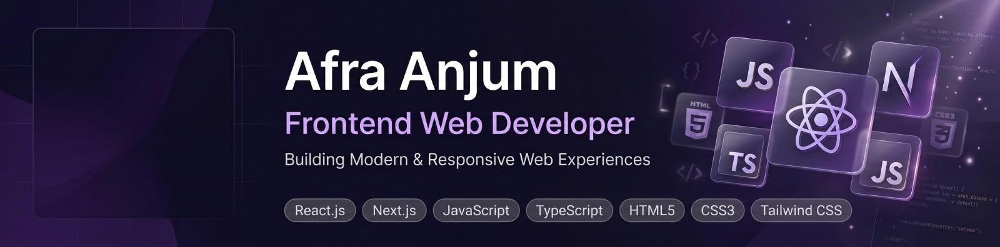

 

  

<h1 align="center">Hi 👋, I'm Afra Anjum</h1>

<h3 align="center">💜 Frontend Developer | MERN Stack Learner 🇧🇩</h3>

  Building responsive, user-friendly, and modern web experiences.

---

## 👩‍💻 About Me

I'm a passionate Frontend Developer from Bangladesh who enjoys creating responsive, interactive, and visually appealing websites. I love exploring modern technologies, learning new skills, and building projects to improve my development journey.

- 🌱 Currently learning **MERN Stack Development**
- 💻 Practicing **React.js, TypeScript, Tailwind CSS, and Next.js**
- 🗄️ Learning **MongoDB** and database integration
- 🔐 Exploring **Authentication with Better Auth**
- 🚀 Building modern web applications and improving my coding skills
- 🎯 Working toward becoming a skilled Full-Stack Developer
- 📫 Reach me at **[afraanjum896@gmail.com](mailto:afraanjum896@gmail.com)**

---

## 🛠️ Languages and Tools

  

---

## 🌐 Connect With Me

  
  
  

---

## 📊 GitHub Stats

  
  

  

---

  💜 <b>Thanks for visiting my profile!</b>
   
  <i>Let's learn, build, and grow together.</i>

